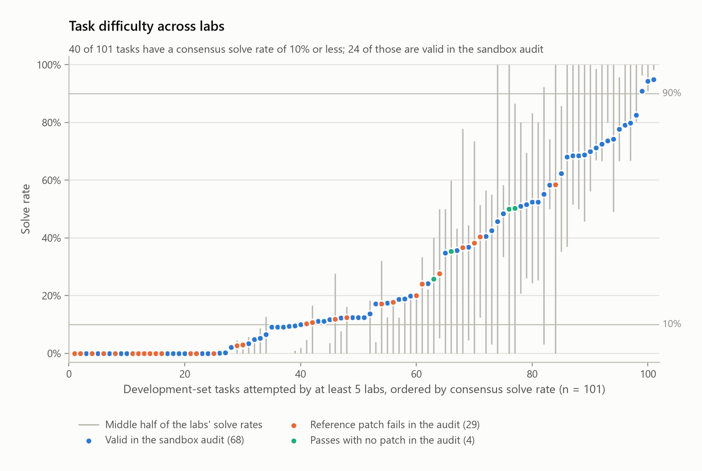
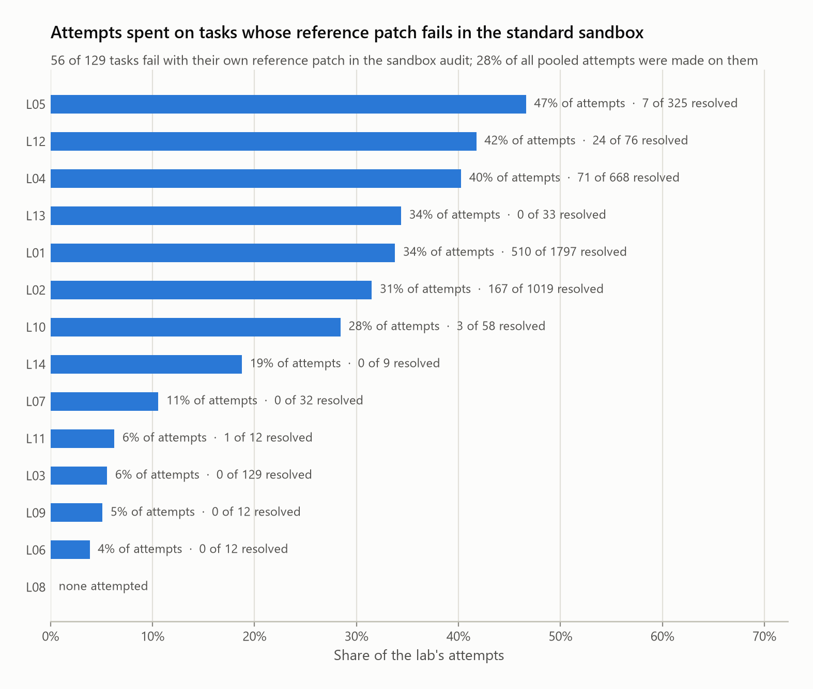

# Many labs, one benchmark

A pooled analysis of the per-task results that participants of Kaggle's
[Gemma 4 Developer Agent](https://www.kaggle.com/competitions/gemma-4-developer-agent)
competition published on GitHub. Each team sees only its own runs on the 129
public development tasks. Pooling the public record answers questions no single
team can: is task difficulty a stable property across independent labs, how
much of an outcome is run-to-run noise, what difference between two agents can
a comparison detect, how far apart are scores that teams report on different
task subsets, and which tasks can be passed at all in the environment teams
actually used.

Entry for the [Paper Track](https://www.kaggle.com/competitions/gemma-4-developer-agent-paper).

- **Paper:** [`paper/paper.md`](paper/paper.md), the text submitted as the Kaggle Writeup.
- **Results:** [`results/RESULTS.md`](results/RESULTS.md) (generated from `results/results.json`).
- **Dataset:** [`data/derived/attempts.csv`](data/derived/attempts.csv), one row per agent run on one task.
- **Plan fixed before the data:** [`ANALYSIS_PLAN.md`](ANALYSIS_PLAN.md), with every later change in [`DEVIATIONS.md`](DEVIATIONS.md).
- **A tool for your own runs:** [`tools/compare_runs.py`](tools/compare_runs.py) says whether the difference between two
  agents on these tasks is larger than the difference between two runs of one agent.

## Main findings

1. **Task difficulty is a property of the task.** Task rankings from two random halves of the 14 labs correlate at
   0.80. Of the 101 tasks attempted by at least five labs, 41 have a consensus solve rate of 10% or less, and 25 were
   never solved by any lab.
2. **One task in ten flips between identical runs.** Between two runs of the same configuration, 10.9% of the shared
   tasks change outcome (mean of labs 10.4%, 95% interval 7.0% to 13.9%).
3. **One comparison detects little.** A single paired comparison on all 129 tasks detects only improvements of about
   8 to 12.5 points. About four runs per agent detect 5 points, and a floor of about 3.4 points remains for claims
   about new tasks, whatever the number of runs.
4. **Scores on different task subsets are not comparable.** Runs used 52 different subsets, on which one median agent
   is predicted to score from 5.6% to 66.7%.
5. **The labs were not running the same benchmark.** Four independent audits of the stock sandbox agree that 51 of
   the 129 tasks fail with their own reference patch; labs with modified environments resolve them. 67 tasks are
   valid, and 41 are both valid and discriminating.

An external dataset that was never pooled (task difficulty correlates at 0.84) and nine further labs found later
(0.89) reproduce the main quantities.

## What is here

| Path | What it is |
|---|---|
| `ANALYSIS_PLAN.md` | Questions, inclusion rules, units and analyses, committed before any per-task outcome file was opened (the commit history shows the order). |
| `DEVIATIONS.md` | Every amendment to the plan, with the time, the reason and whether outcome data had been seen. |
| `data/sources/search_results.json`, `manifest.json` | The candidate repositories returned by the searches and the commit each one is pinned to, with the tarball checksum. |
| `scripts/adapters/` | One adapter per examined source: where its per-task outcomes are, how systems, runs and repeats were identified, the evidence for each decision, and the numbers the source itself reports that the adapter reproduces. `README.md` there states the rules. |
| `data/derived/attempts.csv` | The pooled table: `lab, source, system, run, task, y, model, harness, err, status, file`. 15,112 attempts, 14 labs, 259 agent configurations, 346 runs, 129 tasks. |
| `data/derived/runs.csv`, `sources.csv`, `screening.csv` | One row per run, per source with an adapter, and per candidate repository (with the stage at which it left the study). |
| `data/derived/controls.csv` | Control runs that eight labs published per task: the reference patch, or no patch, applied in their environment. Not agent attempts; used only in the validity analysis. |
| `data/sources/leaderboard_pairs.csv` | Development-set rates and public-leaderboard scores that labs state for the same system, compiled by hand with the file and wording for each. |
| `scripts/mlstats.py`, `test_stats.py` | The estimators and their checks against simulated data with known parameters. |
| `scripts/analyze.py`, `validity.py`, `report.py`, `figures.py` | Analyses, the generated results report and the figures. |
| `scripts/sensitivity.py` | One decision changed at a time, intervals for the flip rate, what repeated runs buy, and what the noise means for a leaderboard. |
| `scripts/noise_model.py`, `tools/compare_runs.py`, `tools/noise_band.json`, `scripts/test_compare_runs.py` | A noise band for a new lab's own task subset, checked leave-one-lab-out, and a standard-library tool that applies it to two sets of result files. |
| `scripts/external_zenodo.py`, `external_validation.py`, `data/derived/external_zenodo_attempts.csv`, `external_zenodo_controls.csv` | An external validation set that is not pooled: run records from Zenodo record 23834104 (T. Toeda, doi:10.5281/zenodo.23834104, Apache-2.0), converted to the same columns, with that record's own check of the reference patch and the empty patch on each task. |
| `scripts/crosscheck.py` | Recomputes the headline numbers without the analysis library. |
| `scripts/search_extended.py`, `scripts/extended_pool.py`, `data/sources/search_results_extended.json`, `data/derived/attempts_extended.csv`, `screening_extended.csv` | A broader search made after the results and the sources it added. They are kept out of every registered number and reported in their own section as a partial replication. |
| `results/tables/tasks.csv`, `task_lists.json` | Per task: consensus solve rate, class, status in the sandbox audits, Rasch difficulty; and ready-made lists (valid tasks, tasks whose reference patch fails in every audit, the informative core). |
| `DATASHEET.md` | What the pooled table is, how it was collected and what a user must know. |
| `tools/check_numbers.py` | Lists the numbers in a text that do not occur in `results/RESULTS.md`: a check for anyone writing about these results. |
| `tools/example/` | Eight small result files for trying `compare_runs.py`: the worked example of the report (systems `veljjanoski/v11@kaggle` and `veljjanoski/v10@kaggle` of the pooled table). |
| `results/` | `results.json`, `RESULTS.md` and the tables behind every figure. |
| `paper/paper.md`, `paper/figures/` | The paper and seven figures (the paper uses five). |

## Reproducing

Python 3.12, `pip install -r requirements.txt` (numpy, scipy, pandas, matplotlib).

From the committed pooled table (no network, about ten minutes):

    python scripts/test_stats.py           # estimator checks on simulated data
    python scripts/analyze.py              # results/results.json and results/tables/
    python scripts/sensitivity.py          # results/sensitivity.json
    python scripts/noise_model.py          # results/noise_model.json, tools/noise_band.json
    python scripts/external_validation.py  # results/external_validation.json
    python scripts/extended_pool.py        # results/extended_pool.json
    python scripts/report.py               # results/RESULTS.md
    python scripts/figures.py              # paper/figures/
    python scripts/crosscheck.py           # independent recomputation of the headline numbers
    python scripts/test_compare_runs.py    # the tool against the pooled repeats

From the sources (needs the GitHub CLI `gh`, logged in; downloads about 130 MB):

    python scripts/fetch_sources.py   # download every source at its pinned commit
    python scripts/discover.py        # structure report per source
    python scripts/triage.py          # licence evidence, task ids outside JSON/CSV
    python scripts/harmonize.py       # run the adapters, write data/derived/
    python scripts/controls.py        # data/derived/controls.csv
    python scripts/screening.py       # data/derived/screening.csv
    python scripts/external_zenodo.py # data/derived/external_zenodo_*.csv, from the archive of Zenodo
                                      # record 23834104 (where to put it: see the top of the script)

Comparing two of your own agents (standard library only):

    python tools/compare_runs.py --a base_run1.jsonl base_run2.jsonl --b new_run1.jsonl new_run2.jsonl

A result file may be the harness's `summary.jsonl` (`instance_id`, `resolved`), a CSV with a task column and an
outcome column, or a JSON list of such records.

To try it without your own runs, `tools/example/` holds two configurations of one lab from the pooled table, four
runs each on the same 61 tasks. With one run each, their 6.6-point difference is inside the noise band (exact
McNemar p = 0.29):

    python tools/compare_runs.py --a tools/example/a_run1.csv --b tools/example/b_run1.csv

With three runs each it is outside (exact test p = 0.020):

    python tools/compare_runs.py --a tools/example/a_run1.csv tools/example/a_run2.csv tools/example/a_run3.csv --b tools/example/b_run1.csv tools/example/b_run2.csv tools/example/b_run3.csv

Third-party snapshots go to `data/raw/`, which is not committed. Sources are
read in place from their tarballs; nothing from a source is executed.

## Data and attribution

The pooled table contains task identifiers, binary outcomes and run labels
taken from the repositories listed in `data/derived/sources.csv`, each at the
commit given there and under the licence given there (Apache-2.0, MIT, MIT-0
or CC BY 4.0). The credit for every run belongs to the lab that produced it.
Repositories without an explicit licence were not used.

The table holds no competition data: no task statements, patches, tests,
repository snapshots or agent traces.

This study is about the benchmark, not about teams. It does not rank or grade
named participants, and figures use lab codes.

## Checks

- Estimators are tested on simulated data with known parameters (`scripts/test_stats.py`).
- The adapters reproduce 119 of 131 numbers that the sources state about themselves; the others are explained in
  the adapters' cards.
- `scripts/crosscheck.py` recomputes the headline numbers with the standard library only.
- An independent statistical review recomputed every reported number with separately written code, and
  second readers compared the pooled rows of the four largest sources with their source rows (12,518 of the
  15,112 rows, no disagreement in the outcome). What they found, and what was changed, is Amendment 4 of
  `DEVIATIONS.md`, with the numbers before and after.
- An external dataset that was never pooled, and nine further sources found by a broader search, reproduce the
  main quantities (`results/RESULTS.md`, last sections).

## Limitations

The pooled runs are what teams chose to publish, not a random sample of what
they ran. Labs differ in agent, budget, hardware, test environment and scorer,
and the study observes these differences rather than controlling them. Two
labs supply most of the repeated runs. See the limitations section of the
paper and `DEVIATIONS.md`.

## AI assistance

The analysis plan, the code in this repository and the generated results
report were drafted with Claude (Anthropic) under the author's direction. The
per-source adapters were written by Claude and checked against numbers the
sources themselves report. The independent review and the audits described
under Checks were also carried out with Claude, by instances that had not
written the code they checked. The text of the paper was drafted with Claude
from the generated results report and reviewed by the author.

## Licence

Code: Apache-2.0, see `LICENSE`. The pooled table is a compilation of facts
from the sources above and is offered under the same terms, subject to the
attribution requirements of each source.
