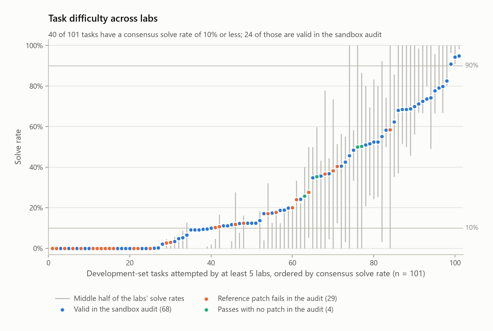
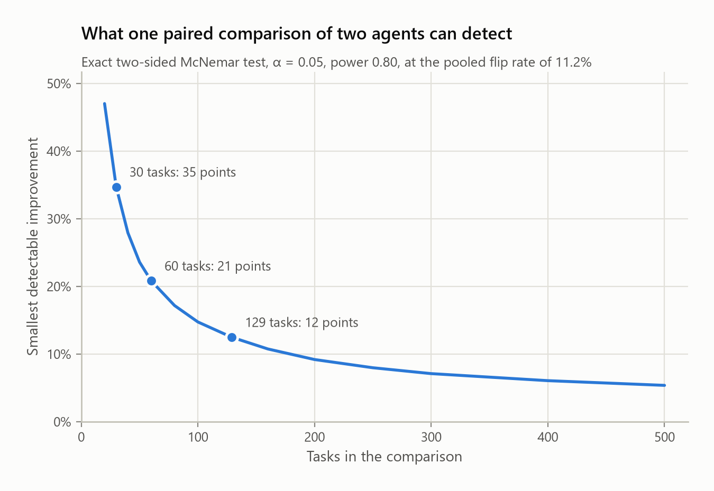
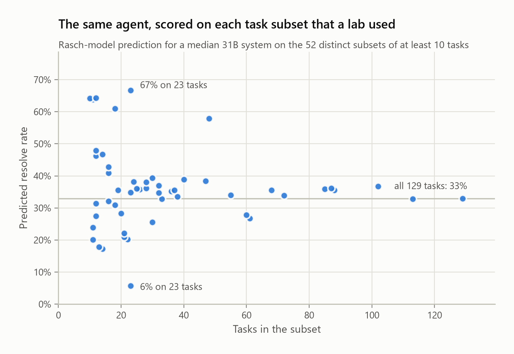
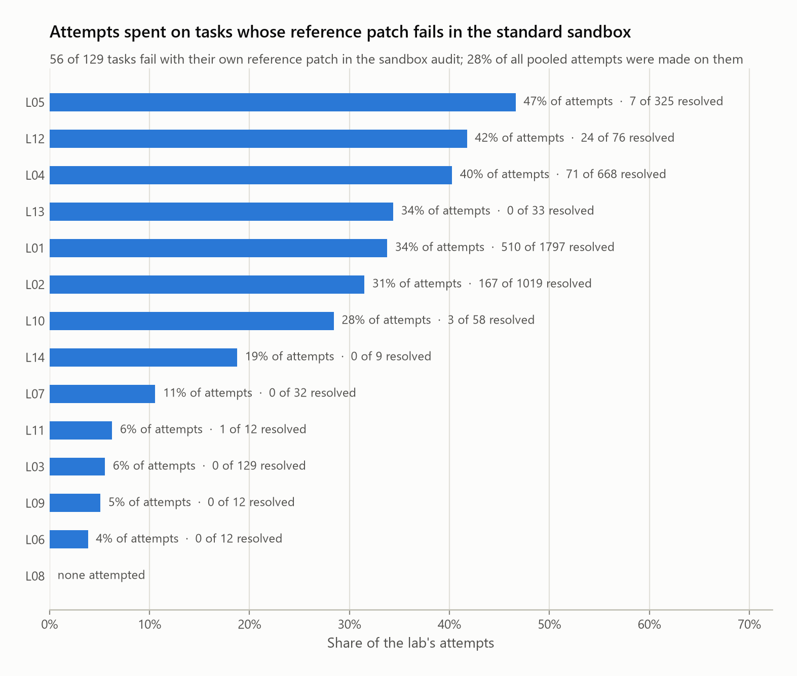
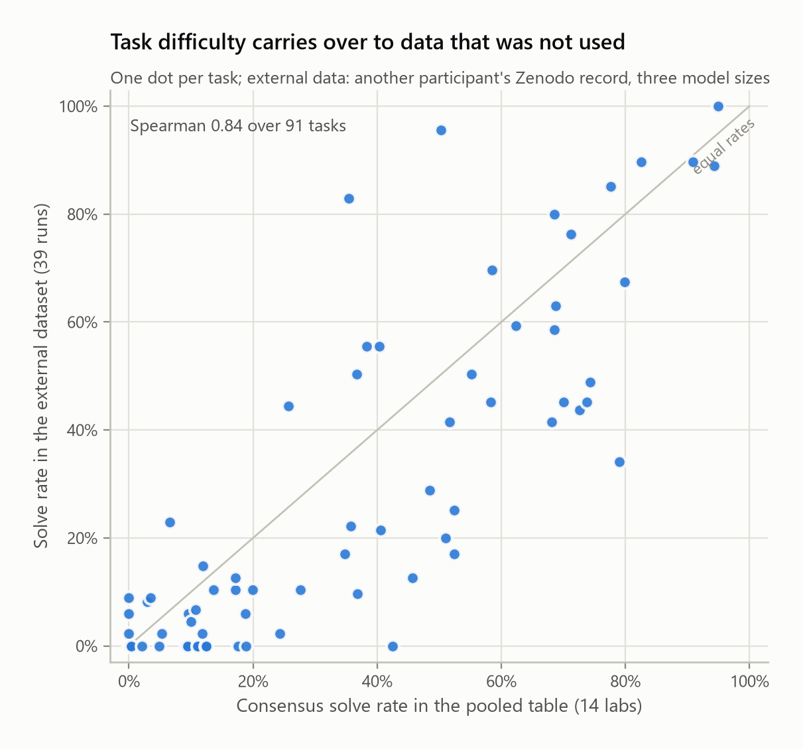

# Many Labs, One Benchmark: A Pooled Analysis of 15,112 Gemma 4 Agent Attempts

*Task difficulty remains consistent across independent labs, around one in ten task outcomes changes between identical runs, and different labs are not always evaluating agents on the same benchmark.*

## Abstract

In the Gemma 4 Developer Agent competition, teams evaluate their agents on the same 129 public development tasks, but each sees only its own results. We combined the per-task results published by 14 independent teams (labs): 15,112 attempts across 346 runs and 259 agent configurations. The main analyses followed a plan committed before the result files were examined.

First, task difficulty is consistent across labs: task rankings from two random halves of the labs correlate at 0.80, and 41 of the 101 tasks attempted by at least five labs have a solve rate of 10% or less. Second, 10.9% of task outcomes changed between two runs of an identical configuration. Third, a single paired comparison across all 129 tasks can reliably detect only improvements of about 8 to 12.5 percentage points; about four runs per agent detect a five-point improvement, but repeated runs cannot remove the uncertainty about unseen tasks. Fourth, the labs used 52 different task subsets, across which the predicted score of one agent varied from 5.6% to 66.7%. Finally, four independent audits of the standard testing environment found that 51 tasks failed even with their own reference patches, while labs with modified environments resolved them: not every team was evaluating the same benchmark.

An external dataset and nine additional labs support these observations. We release the pooled dataset, task lists, and a tool that compares two agents while accounting for evaluation noise.

## 1. Introduction

Every team in an AI agent competition asks whether a change to its system has actually improved performance, and answers by comparing development-set scores. But is a four-point gain real, or randomness between runs? Is a task genuinely difficult, or does it fail because of the testing environment? Can results from 30 tasks be compared with results from all 129? One team, with a few runs, its own task subset, and often its own environment, cannot answer these questions.

Many teams, however, published their per-task results on GitHub. Following the Many Labs studies in psychology [1], which pool independent groups to test whether a finding holds across laboratories, we treat each team as a lab and the shared development benchmark as the common instrument.

We contribute a consolidated dataset of 15,112 attempts from 14 labs, an analysis planned in advance with exploratory checks of benchmark validity, and practical guidance with a tool that applies it.

## 2. Related Work

Liu et al. [2] analyzed published per-task results from 254 SWE-bench [3] submissions and showed that leaderboard rankings do not reliably distinguish the strongest submissions. Bjarnason et al. [4] studied the randomness of repeated agent evaluations on SWE-bench Verified. Ge et al. [5] applied item response models across agentic coding benchmarks. Miller [6] and Card et al. [7] argued for error bars and statistical power in evaluations. SWE-bench Verified [8] showed that many tasks in the original benchmark could not be solved as specified. Some teams in this competition also reported inconsistent repeated runs and failing reference patches.

Our work combines what these studies examined separately: repeated evaluations from multiple independent labs, benchmark validity from four independent audits, and one scale across 52 task subsets, under an analysis plan established before the outcome data were examined.

## 3. Methods

### 3.1 Data collection

Six GitHub search queries returned 128 repositories associated with the competition, of which 121 were retrieved at pinned commits; 58 contained development-set task identifiers, 35 of those had an explicit open-source licence, and 14 had at least one usable run (per-task outcomes for at least ten tasks). A separate adapter per source converts its files into a shared structure (lab, configuration, run, task, outcome, model, scorer, error flag). The adapters reproduce 119 of the 131 summary values reported by the sources; the remaining differences are documented in the adapter cards.

### 3.2 Units of analysis

An **attempt** is one agent execution on one task, a **run** one evaluation over a set of tasks, a **configuration** an agent setup as identified by its lab, and a **lab** one contributing GitHub account. Of the 15,112 attempts, 25.3% were successful. Most runs used the 31B model (265); the others used E4B (65) and E2B (16). Three labs accounted for approximately 72% of all attempts, so we applied equal lab weighting: repeated runs were averaged within each configuration, configurations within their lab, and each lab contributed equally.

### 3.3 Analysis plan

Before opening any outcome file, we committed the research questions, inclusion criteria, analysis units, and estimators to a Git repository and tested the estimators on simulated data. The plan covered four areas: (1) task difficulty, with a split-half reliability analysis; (2) a variance decomposition with an estimate of run-to-run noise; (3) the flip rate between repeated runs and the smallest improvement detectable with 80% power at the 5% level by an exact McNemar test [9]; (4) a one-parameter Rasch model [10], in which the chance of success depends on agent ability minus task difficulty, to place agents and tasks on a common scale.

The validity analysis, sensitivity checks, and replications came after the initial results and are treated as exploratory. Changes to the plan are documented in `DEVIATIONS.md`; the estimators are specified in `ANALYSIS_PLAN.md` and implemented in `scripts/mlstats.py`.

### 3.4 Independent review

An independent review then recomputed every reported statistic with separately written code, and three audits compared 10,214 pooled rows against their source files. No transcription errors were found. The review identified two incorrect derivations, one check that was true by construction, one weighting issue, one interval that was too narrow, and one misleading claim; all were corrected, and the original and corrected values are published.

## 4. Experiments and Results

### 4.1 Task difficulty is consistent across independent labs (planned)

We randomly divided the 14 labs into two groups, ranked the tasks by solve rate in each, and repeated this 2,000 times. The median Spearman correlation between the rankings was 0.80: labs with different agents, budgets, and hardware generally agreed on which tasks were difficult. Task identity accounted for 44.9% of the variation in outcomes and lab identity for 14.6%.

Among the 101 tasks attempted by at least five labs, 41 had a consensus solve rate of 10% or less (25 were never solved by any lab), 3 had at least 90%, and 57 fell in between.

*Figure 1. Consensus solve rates of the 101 tasks attempted by at least five labs, coloured by status in the four sandbox audits (Section 4.5).*

### 4.2 Approximately one in ten outcomes changes between identical runs (planned)

We identified 49 configurations across nine labs that had been evaluated more than once, providing 127 pairs of repeated runs. Between two runs of the same configuration, 10.9% of the shared task outcomes changed. Two labs contributed 86% of the weight of this pooled estimate, so we also gave each lab equal weight: the average flip rate was 10.4%, with a 95% interval from 7.0% to 13.9%. The overall score hides much of this variation: two repeated runs differed by 3.3 percentage points on average, yet only 14% of the pairs produced the same outcome on every shared task. Run-to-run variation accounted for 22.8% of the outcome variance in the cells with repeated evaluations.

In about half of these outcome changes (51%), the failing attempt carried a timeout, budget, or tool-error flag: much of the inconsistency comes from an agent that sometimes finishes in time and sometimes does not.

### 4.3 Detecting improvements needs repeated runs (planned, extended after review)

Suppose a team evaluates an existing agent and a modified version once each on the same tasks and applies an exact McNemar test. With 80% power, the smallest detectable improvement is 12.5 percentage points across 129 tasks, 20.8 across 60, and 34.5 across 30. This is the planned worst case, in which newly solved tasks move from never solved to always solved. When the improvement introduces no additional disagreement, the figure for 129 tasks decreases to approximately 8.2 points. The median run in our dataset covers only 30 tasks.

*Figure 2. Minimum detectable improvement for one paired comparison, by number of tasks. The band runs from no additional disagreement to the planned worst case.*

Repeated evaluations make comparisons more reliable, but two questions must be kept apart. *Is the new configuration better on the tasks in the experiment?* Only run-to-run noise matters: approximately four runs per agent are required to detect a five-point improvement on 129 tasks, seven on 60, and fourteen on 30. *Will it also perform better on tasks that were not included?* This adds the uncertainty of which tasks were selected, and additional runs cannot remove it. Using variance components [11] from the four labs with balanced evaluation blocks, the smallest detectable improvement on unseen tasks stays at approximately 3.4 percentage points for 129 tasks and 5.1 for 58 even without any run-to-run noise, with a wide range across labs.

**Table 1. Minimum detectable improvement (percentage points) with 80% power at the 5% significance level.** Column 2 is the worst case of the exact test; columns 3 and 4 use the disagreement observed between configurations.

| Runs per agent | Same 129 tasks | New tasks (129 sampled) | New tasks (58 sampled) |
|---|---:|---:|---:|
| 1 | 12.5 (8.2–12.5) | 8.6 | 12.9 |
| 3 | 5.3 | 5.7 | 8.5 |
| 5 | 4.1 | 4.9 | 7.4 |
| 10 | 2.8 | 4.2 | 6.3 |
| No run-to-run noise | 0 | 3.4 (0–6.0) | 5.1 (0–8.9) |

### 4.4 Results from different task subsets are not directly comparable (planned)

The collected runs covered 52 different task subsets, and no subset was shared by two labs. The Rasch model allowed us to estimate how one agent would perform on each of them. For a median 31B configuration, the predicted solve rate ranged from 5.6% to 66.7%, against 32.9% across all 129 tasks. Both extremes were subsets that a lab had selected using its own earlier results. After excluding the six subsets of that kind, the range narrowed to 17.7%–64.4%, and to 25.5%–39.3% among subsets of at least 30 tasks. Selecting tasks based on earlier outcomes has the largest effect on reported performance; small subsets come next. On held-out observations, the model's predicted resolution rate for a run differed from the observed rate by 1.9 percentage points on average.

*Figure 3. Predicted performance of a median 31B configuration on the 52 task subsets. Orange: subsets selected from earlier results.*

### 4.5 The labs were not always evaluating the same benchmark (exploratory)

Eight labs published control evaluations: the reference patch supplied with each task, or no patch at all, applied in their environment. Four of them audited all 129 tasks in the competition's standard sandbox. The four audits agreed on 120 tasks: the reference patch passed in all four for 69 tasks and failed in all four for 51. We classified a task as valid if its reference patch passed in all four audits and the task did not pass without a patch; 67 tasks were valid. The failures are related to the testing environment rather than the tasks themselves: in one lab's Docker environment with per-task dependencies, the reference patch passed on 105 tasks, including 33 of the 51.

Approximately 24.6% of all attempts were made on these 51 tasks, but the results differed sharply across labs. Ten labs resolved none of them: five did not attempt them at all, and the other five failed all 388 attempts. In contrast, four labs resolved 21.6% of their 3,331 attempts on these tasks, and all four documented testing environments that differed from the standard sandbox. The same task identifiers were effectively representing different evaluation conditions across teams.

*Figure 4. Share of each lab's attempts made on the 51 tasks. Blue: labs that resolved some of them. Grey: labs that resolved none.*

Of the 41 difficult tasks of Section 4.1, 23 were valid: genuinely challenging for the evaluated models rather than affected by the environment. Across all 129 tasks, only 41 were both valid and able to distinguish between agents. The main findings held on the valid tasks alone: split-half reliability 0.86, flip rate 11.9%.

## 5. Replication

Neither dataset below entered the original analysis, and both checks were made after the primary results.

**An independent dataset.** A pre-registered study by another participant [12] contains 4,056 attempts across 104 tasks with three model sizes (E4B, 12B, and 26B-A4B) in a repaired testing environment. Across the 91 shared tasks, its solve rates correlate at 0.84 with our consensus estimates (Figure 5), and its flip rate between random seeds is 13.3%.

**Additional labs.** A broader search after the primary analysis identified nine additional labs with 9,876 attempts. On their own, they show a split-half reliability of 0.88, a run-to-run noise share of 22.1%, and a lab-level flip rate of 9.4% (95% interval 5.5%–13.2%). Task difficulty estimates from the original 14 labs correlate at 0.89 with those from the nine new labs. This check is partial: only 16 of the 33 licensed candidate repositories were examined, in an order fixed before their outcomes were reviewed, and only the largest new source was recounted independently.

The noise intervals estimated from the pooled dataset covered 96.1% of the repeated run pairs when each lab in turn was left out of the fit, and 95.7% of the pairs in the external dataset.

*Figure 5. Consensus solve rates in the pooled dataset against the external dataset, one point per task.*

## 6. Recommendations

### 6.1 For participating teams

1. **Check validity first:** apply the reference patch and the no-patch control to every task in your environment.
2. **Report repeated runs** and the observed flip rate.
3. **Use paired comparisons** on the same tasks with an exact test; a five-point improvement on 129 tasks needs about four runs per agent.
4. **Document the task subset,** do not choose it from earlier outcomes, and use at least 50 tasks where possible.
5. **Treat small gains with care:** about three percentage points or less on the development set is not evidence for unseen tasks.
6. **Publish per-task results** under a licence. This study was possible because 23 labs did.

### 6.2 For benchmark organisers

Provide a reliable testing environment for each task: in the four labs' audits, 51 of the 129 public tasks failed their own reference patches in the standard sandbox. For a leaderboard split of about 58 tasks, the size participants infer, two agents with a true difference of five percentage points appear in the wrong order about 12% of the time, and resubmitting one unchanged agent five times raises its best score by 3.6 percentage points on average.

### 6.3 Beyond this competition

None of this is specific to Gemma 4 or to this benchmark. The external dataset used other model sizes and a repaired environment and showed the same task ordering and a similar flip rate. The planning numbers depend only on the flip rate and the number of tasks, and the pooling method only on teams publishing per-task outcomes, so both carry over to any shared agent benchmark.

## 7. Limitations

The analysis is observational: the labs differed in agents, budgets, hardware, testing environments, and scoring procedures, and none of these were controlled. The dataset depends on which teams chose to publish their results and is not a random sample of all experiments. Identifying repeated evaluations depends on how labs labelled their setups; under a stricter interpretation, the flip rate decreases to 10.2%. Estimates of variation between configurations within a lab are based on two to seven degrees of freedom, so the uncertainty for new tasks is itself uncertain. The plan was committed to a Git repository that became public only with this paper, so its timing rests on the commit history. This study does not measure performance on the hidden test set.

## Reproducibility and Use of AI

All code, data, and analysis materials are available at https://github.com/yuvrajtiwary-bitmesraece/gemma4-many-labs under the Apache-2.0 licence. Ten commands regenerate the reported statistics, tables, and figures from the committed pooled dataset, and a separate workflow reconstructs that dataset from the original sources at pinned commits. The repository includes the dataset with its datasheet, the task lists (67 valid tasks; 41 valid and discriminating), and `tools/compare_runs.py`, which applies the estimated noise intervals to anyone's evaluation results.

Claude (Anthropic) was used, under the author's direction, to develop the analysis plan, the code, the adapters, the figures, and the results report. The independent review and the source audits were also carried out with Claude, using separate instances that had not written the code being checked. The manuscript was drafted with Claude from the generated results report and reviewed by the author.

## Acknowledgements

We thank the 23 contributing sources, listed in the repository with commit and licence, and T. Toeda for the external dataset.

## References

1. Klein et al. *Investigating Variation in Replicability: A "Many Labs" Replication Project.* Social Psychology 45(3), 2014.
2. Liu et al. *Coding Agents Have Converged.* arXiv:2609.17394, 2026.
3. Jimenez et al. *SWE-bench: Can Language Models Resolve Real-World GitHub Issues?* ICLR 2024.
4. Bjarnason, Silva, Monperrus. *On Randomness in Agentic Evals.* arXiv:2602.07150, 2026.
5. Ge et al. *Agent psychometrics: Task-level performance prediction in agentic coding benchmarks.* arXiv:2604.00594, 2026.
6. Miller. *Adding Error Bars to Evals.* arXiv:2411.00640, 2024.
7. Card et al. *With Little Power Comes Great Responsibility.* EMNLP 2020.
8. Chowdhury et al. *Introducing SWE-bench Verified.* OpenAI, 2024.
9. Dietterich. *Approximate Statistical Tests for Comparing Supervised Classification Learning Algorithms.* Neural Computation 10(7), 1998.
10. Rasch. *Probabilistic Models for Some Intelligence and Attainment Tests.* Copenhagen, 1960.
11. Brennan. *Generalizability Theory.* Springer, 2001.
12. Toeda. *Scaffolding Helps the Smallest Gemma 4 Agent, Not the Larger Ones.* Zenodo, doi:10.5281/zenodo.23834104, 2026.
